# Titles Sorter

<p align="center">
  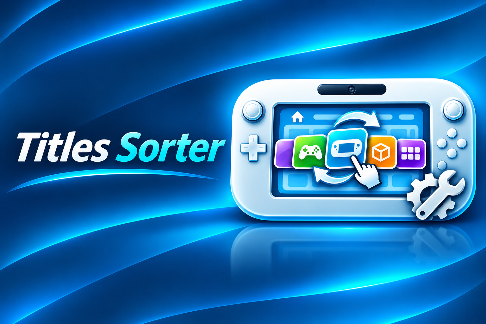
</p>

<p align="center">
  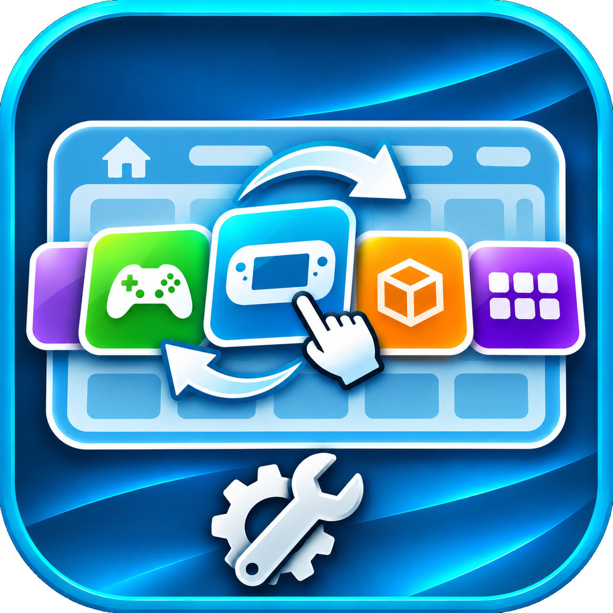
</p>

**A Wii U homebrew project for organising titles on the Wii U HOME Menu.**

Titles Sorter reads the current HOME Menu layout, builds a sorting plan, previews the proposed arrangement and provides manual/automatic backup, Restore and Apply operations. The current source is the v1.0.0 pre-release candidate; target and physical-console validation remain release gates.

> [!WARNING]
> **Experimental software — use at your own risk.** The APPLY and RESTORE UI is connected to the Wii U save platform adapter, but this snapshot has not been built with devkitPPC or tested on a physical console. The Home Menu save format and page/slot mapping are still based on experimental analysis. Do not press Apply on your only save copy. Keep an independent backup before testing any write operation; a host test pass does not prove real-console safety.

## Screenshots

<p align="center">
  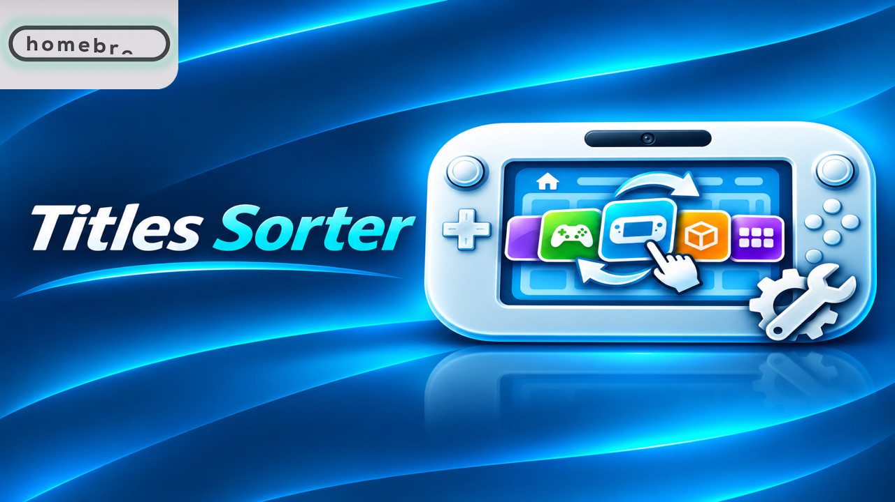
</p>

<p align="center">
  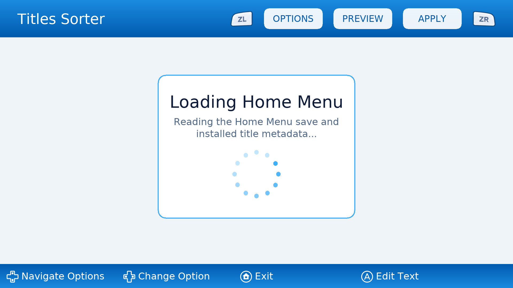
</p>

<p align="center">
  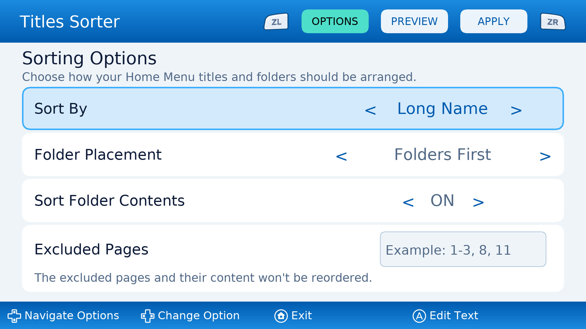
</p>

<p align="center">
  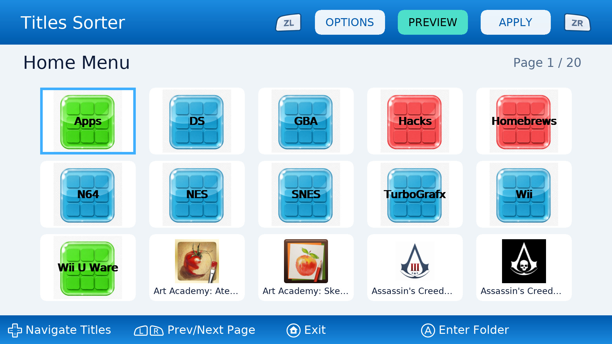
</p>

<p align="center">
  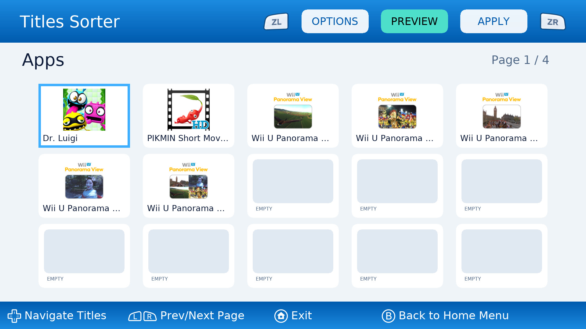
</p>

<p align="center">
  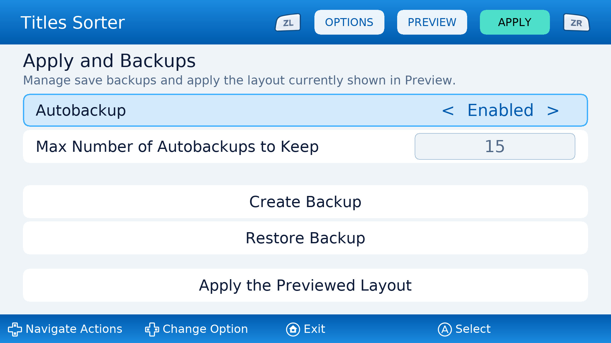
</p>

<p align="center">
  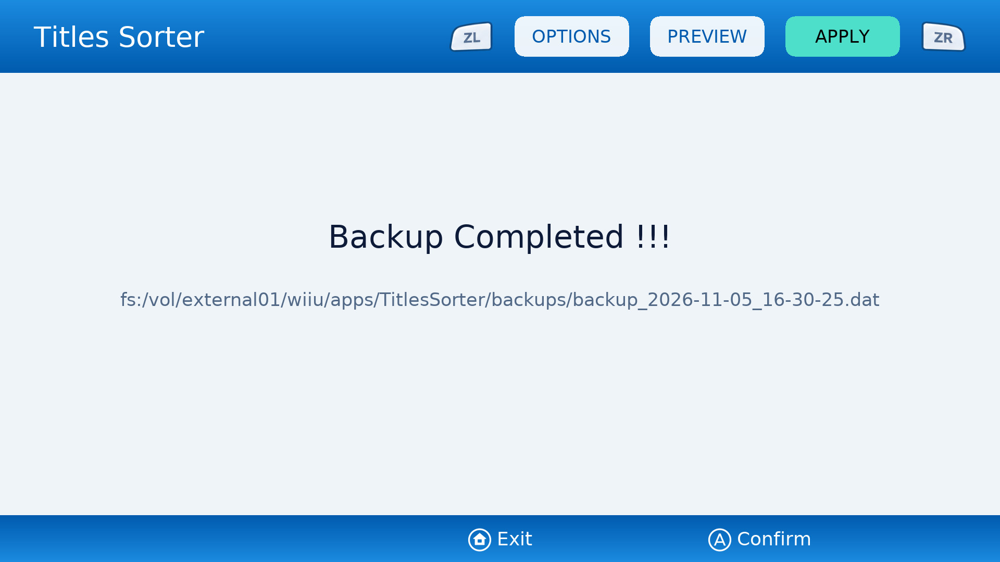
</p>

<p align="center">
  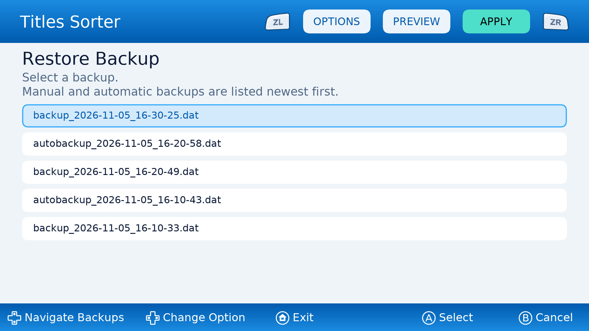
</p>

<p align="center">
  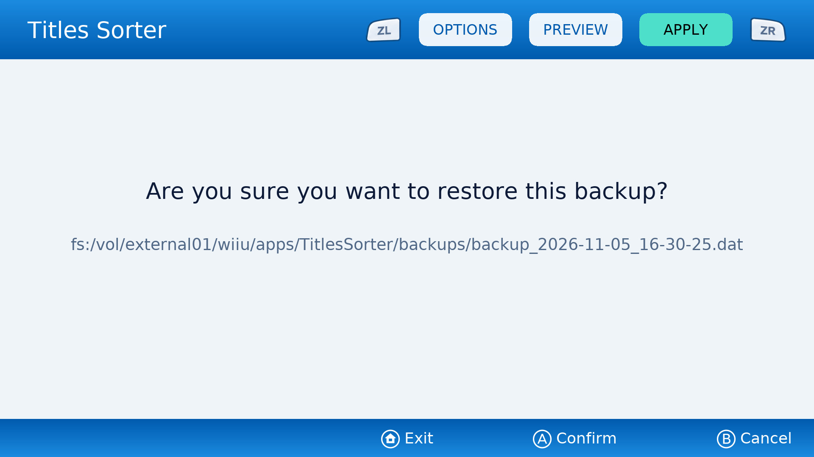
</p>

<p align="center">
  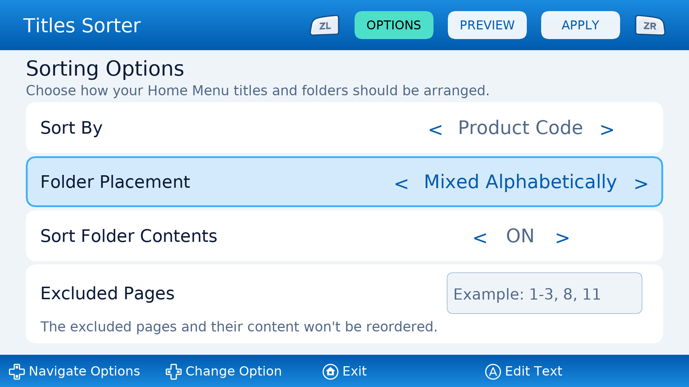
</p>

<p align="center">
  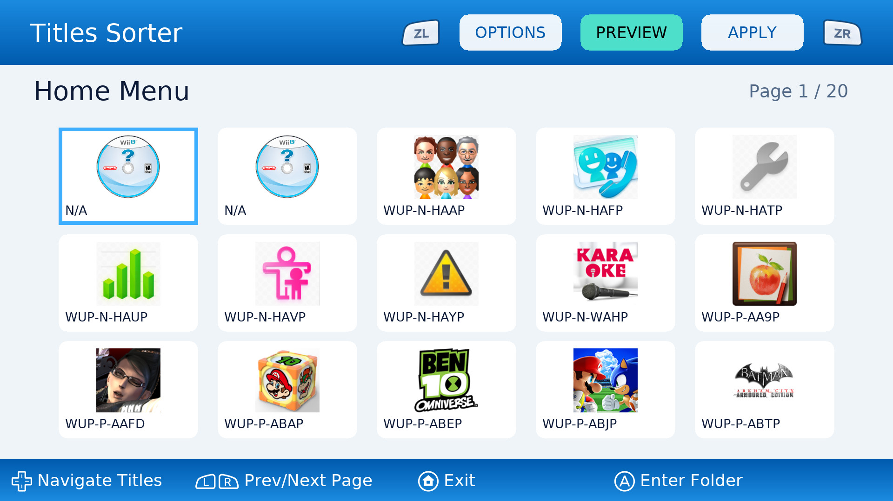
</p>

## Project status

| Area | Status |
|---|---|
| Home Menu save discovery and reading | Implemented; hardware validation required |
| Save parsing and sorting planner | Implemented; format understanding is incomplete |
| Sorting options and preview UI | Implemented; hardware validation required |
| Folder preview and folder-content planning | Implemented; hardware validation required |
| Wii U title metadata and artwork | Implemented; hardware validation required |
| Settings persistence | Implemented; hardware validation required |
| Backup / Restore UI and platform integration | Implemented in development source; hardware validation required |
| In-memory save patch candidate | Implemented; host tests only, experimental format assumptions |
| Save writing / applying a new layout | Implemented in development source; experimental, target/hardware validation pending |
| Full validation on a physical Wii U | Pending for this source snapshot |

The **v0.5.0** release was the read-only inspection and preview milestone. The current source is the **v1.0.0 pre-release candidate**: it includes manual/automatic backups, Restore, an in-memory save patcher and a staged Apply transaction with rollback/recovery. It is not ready for public release until the Wii U target build, full host suite, save-format invariants and physical-console tests have been completed. Application settings remain separate from the Home Menu save.

## Features in this snapshot

- Reads and analyses the Wii U Home Menu save data and supports experimental manual backup, Restore and Apply operations through the Wii U platform adapter.
- Builds a sorting plan and previews the planned Home Menu arrangement.
- Supports sorting options and excluded-page expressions.
- Provides OPTIONS, PREVIEW and APPLY in that top-bar order. ZL/ZR navigation is explicit between the three screens; entering PREVIEW generates it immediately. The APPLY panel uses five vertically stacked, equal-size full-width controls: Autobackup, maximum autobackups, Create Backup, Restore Backup and Apply the Previewed Layout. The maximum-to-Create and Restore-to-Apply vertical gaps are 70 logical pixels. Create Backup runs immediately on A and then displays a success/failure result with the created path or error; only A acknowledges the result (HOME exits). Restore selection opens a dedicated A/B decision frame with the selected path, then displays a success/failure result; both successful and failed Restore operations request a reload after A acknowledges the result. Apply follows the same result-then-acknowledgement-then-reload lifecycle, whether it succeeds or fails. Apply opens an A/B decision frame. Decision frames show HOME/Exit centred plus A/Confirm and B/Cancel on the right; operation-result frames show HOME/Exit centred and A/Confirm on the right (B is disabled); the main APPLY bottom bar remains the OPTIONS-style layout with Select.
- Supports opening a folder in Preview and returning to the previous page/selection.
- Retrieves metadata for installed system titles and Homebrew on Menu entries. WUHB metadata/icons are read directly from SD bundles through libwuhbutils, with a TGA decoding fallback for bundle artwork; `resources/unknown.png` is the generic fallback and `resources/lock.png` marks fixed tiles. Disc and Wii entries use their nominal system Title IDs, localized channel names where available, and remain sortable like ordinary channels; neither has a Product Code listed in the WiiUBrew title database.
- Persists application settings.
- Includes a portable host-side test suite for core logic and selected platform/UI adapters.
- Prepares bundled artwork at build time, keeping high-resolution source images separate from runtime assets.

See [docs/FEATURES_AND_STATUS.md](docs/FEATURES_AND_STATUS.md) for implementation details and known limitations, and [CHANGELOG.md](CHANGELOG.md) for the development history.

## Screenshots

The screenshots above document the earlier preview-focused UI. Updated APPLY/OPTIONS/PREVIEW screens have not yet been captured from a verified hardware build. The source snapshot has passed its host-side tests, but the Wii U target build and physical-console smoke test must be completed before publishing a binary release.

## Build at a glance

The project has three separated build pipelines, orchestrated by the top-level `Makefile`:

- **Resource import:** Python 3.10+ and Pillow; `makeresources.mk` discovers a usable interpreter automatically, including Windows Python installations visible to MSYS2.
- **Wii U application:** devkitPro, devkitPPC, WUT, Wii U SDL2 port libraries, libmocha and libwuhbutils; the Aroma environment must also provide WUHBUtilsModule. `makeapp.mk` consumes generated resources and does not invoke Python.
- **Windows host tests:** MSYS2 with the UCRT64 GCC toolchain. Wii U SDK libraries are replaced by test doubles where applicable.

The commands below are a quick reference. Future-dated file timestamps are normalised automatically before resource import, Wii U compilation and host tests; `make normalize-timestamps` can also be run manually. For a clean machine setup, package details and troubleshooting, follow the dedicated guides:

- [Build environment setup](docs/BUILD_ENVIRONMENT.md)
- [Build and test guide](docs/BUILD_GUIDE.md)
- [Troubleshooting](docs/TROUBLESHOOTING.md)

### Quick commands

Run commands from the repository root in an MSYS2 shell configured for the relevant toolchain.

```sh
# Import/optimise resources only
make resources

# Build the Wii U application (resources first, then RPX and WUHB)
make

# Force a fresh resource import
make resources-rebuild

# Build and run the host-side test suite
make tests

# Build the read-only host save-planner utility
make dryrun

# Repair future-dated files manually (also runs automatically before builds)
make normalize-timestamps

# Remove generated outputs
make clean
```

The Wii U build first runs `makeresources.mk` to generate runtime artwork under `build/assets/wiiu/`, then runs `makeapp.mk` to compile the application. Intermediate files are placed under `build/wiiu/`, and the distributable WUHB is copied to `build/wiiu/release/`.

### Build-time artwork processing

Original artwork is kept in `resources/`. During the Wii U build, `tools/prepare_assets.py` uses Python 3 and Pillow to generate the runtime PNG assets in `build/assets/wiiu/`. Folder artwork is resized to the runtime dimensions before being embedded; `unknown.png` is prepared at 256×256 and `lock.png` at 48×48, while ZL/ZR artwork retains its source dimensions. The application loads the generated assets and does not resize folder artwork at runtime. See the [build guide](docs/BUILD_GUIDE.md#build-time-asset-pipeline).

### Restore safety backup

When Autobackup is enabled, Restore first reads, stages and verifies the selected backup, then creates an automatic backup of the currently active Home Menu save before replacing it. If the safety backup cannot be completed, Restore is cancelled, the staging file is removed and the active save is left untouched. The selected backup is staged before retention runs, so it remains restorable even if retention removes its original file. The Restore result screen reports the safety backup path when one was committed.

## Repository layout

```text
include/       Public/internal C++ headers
src/core/      Portable save parsing, sorting, patch candidate, backup and settings logic
src/ui/        UI controller and SDL renderer
src/platform/  Wii U platform adapters and application entry point
src/tools/     Host-only read-only save-planner utility
resources/     High-resolution source artwork
fonts/         Bundled font asset
meta/          WUHB icon and boot-screen assets
tests/         Host tests, mocks and test fixtures
docs/          Architecture, integration and build documentation
tools/         Build-time asset preparation and Python discovery scripts
Makefile       Top-level build dispatcher
makeresources.mk Resource import and optimisation pipeline
makeapp.mk     Wii U application compilation pipeline
maketests.mk   Windows host-test compilation pipeline
build/         Generated build output (not tracked by Git)
```

## Safety and privacy

- The current development source can write/replace the active Home Menu save when the user explicitly confirms Restore or Apply. The binary format and page/slot mapping remain experimental, and no devkitPPC build or physical-console test has been performed for this snapshot.
- Do not press Apply on the only copy of valuable save data. Keep an independent backup outside the console's active save and test first with a disposable/replaceable save. A successful host test does not prove the Wii U filesystem's rename or power-loss behaviour.
- Do not publish personal console data, dumps, save files, logs containing identifiers, or other user-provided material in issues, pull requests, test fixtures or releases.
- `tests/fixtures/sample_menu_save.dat` is a local development/test input and is excluded from Git by `.gitignore`; it will not be included in a normal Git commit. The core integration test expects this file to exist locally, so maintainers must keep their private test fixture in place when running `make tests`. Verify exclusions with `git check-ignore -v tests/fixtures/sample_menu_save.dat` before committing.

## Release scope and versioning

- `v0.5.0` is the read-only milestone: inspection, sorting configuration, preview, metadata/artwork lookup, and separate application-settings persistence.
- `v1.0.0` must not be released until the devkitPPC build, save-format invariants, backup/Restore recovery and physical-console Apply tests have passed.
- A Git tag should identify each source release. Attach the matching `.wuhb` only after a successful devkitPPC/WUT build and a physical-console smoke test.
- See [Release checklist](docs/RELEASE_CHECKLIST.md) and [GitHub publishing guide](docs/GITHUB_PUBLISHING.md).

## Contributing

Bug reports and focused contributions are welcome. Please include:

- The exact source revision and build command.
- Whether the issue occurs in host tests, in the Wii U build, or on physical hardware.
- Relevant compiler output and a minimal reproduction.
- For hardware issues, console environment details (for example Aroma version and whether the issue occurs after a cold launch or HOME-menu resume).

**Never attach a personal Home Menu save dump.** If a report requires save data, provide a fully synthetic and reproducible fixture instead.

## License

No `LICENSE` file is included. This is intentional for the current release; do not assume that the source is licensed for redistribution, modification or reuse.

## Support ❤️❤️❤️
If you find Titles Sorter useful and would like to support its future development, or simply say thank you, please consider leaving a tip. 😊
<https://ko-fi.com/apache81>
